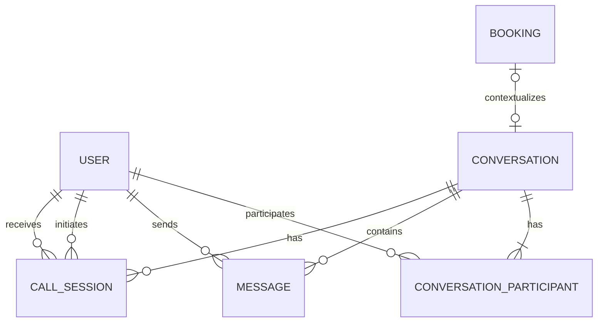

# CHAT & VIDEO CALL — BUSINESS / FUNCTIONAL SPECIFICATION

> **Tài liệu đặc tả nghiệp vụ và yêu cầu sản phẩm (BA Specification)**  
> **Phạm vi:** Chat 1–1 và gọi video 1–1 trong website booking hiện có  
> **Định hướng:** MVP thực hành, ưu tiên công nghệ miễn phí; tận dụng hệ thống người dùng, phân quyền, booking và UI hiện có  
> **Đối tượng đọc:** BA, Product Owner, UI/UX Designer, Developer, QA/Tester và AI coding agent  
> **Ngôn ngữ:** Tiếng Việt  
> **Trạng thái tài liệu:** Baseline đề xuất — cần đối chiếu codebase/schema hiện tại trước khi chốt tên bảng, tên field và API thực tế.

---

## 0. Quy ước đọc tài liệu

### 0.1. Mức độ ưu tiên

- **P0 — Must have:** Bắt buộc để MVP hoạt động an toàn và có thể nghiệm thu.
- **P1 — Should have:** Nên có nếu không làm ảnh hưởng đáng kể đến tiến độ MVP.
- **P2 — Could have:** Có thể đưa vào giai đoạn sau.

### 0.2. Loại yêu cầu

- **BR:** Business Rule — quy tắc nghiệp vụ.
- **FR:** Functional Requirement — yêu cầu chức năng.
- **NFR:** Non-functional Requirement — yêu cầu phi chức năng.
- **DR:** Data Requirement — yêu cầu dữ liệu.
- **API:** Hợp đồng HTTP API.
- **RT:** Realtime event contract.
- **AC:** Acceptance Criteria — tiêu chí nghiệm thu.
- **UX:** Yêu cầu giao diện và trải nghiệm.

### 0.3. Quy tắc thiết kế đặc tả

1. Tên bảng, collection, route, component và field trong tài liệu là **logical proposal**, không mặc định phải tạo mới đúng nguyên văn.
2. Trước khi triển khai, cần map yêu cầu này vào entity, API, auth, booking và UI hiện có. Nếu dự án đã có cấu trúc tương đương thì mở rộng cấu trúc đó, không tạo bản sao.
3. Không coi trạng thái hiển thị ở frontend là nguồn dữ liệu có thẩm quyền. Quyền truy cập, trạng thái nghiệp vụ và các thay đổi quan trọng phải được backend xác thực.
4. Không lưu nội dung media/audio/video trực tiếp trong database. WebRTC truyền media giữa các peer; hệ thống chỉ quản lý metadata và signaling cần thiết.
5. Các thời hạn như giới hạn ký tự, thời gian timeout và retention bên dưới là **giá trị mặc định đề xuất cho MVP**, cần hiệu chỉnh theo codebase và nhu cầu sản phẩm trước khi release.
6. Spec xác định **hành vi sản phẩm và hợp đồng dữ liệu**, không bắt buộc một thư viện/framework cụ thể nếu kiến trúc hiện tại đã có giải pháp tương đương.

---

# 1. Tổng quan sản phẩm

## 1.1. Bối cảnh

Website booking cho phép người dùng tìm/đặt dịch vụ hoặc cơ sở. Chat giúp khách hàng trao đổi trực tiếp với bên cung cấp dịch vụ về booking, thông tin và câu hỏi liên quan. Gọi video là kênh giao tiếp bổ sung, cho phép hai bên trao đổi trực tiếp khi cả hai đang trực tuyến và có quyền tham gia.

## 1.2. Mục tiêu

- Cho phép hai người dùng hợp lệ gửi và nhận tin nhắn trong cùng một cuộc hội thoại.
- Gắn ngữ cảnh hội thoại với booking hoặc dịch vụ khi có liên quan.
- Hiển thị lịch sử tin nhắn sau khi tải lại trang hoặc đăng nhập lại, tùy quyền truy cập.
- Cho phép một bên khởi tạo cuộc gọi video 1–1 tới người còn lại.
- Hiển thị rõ trạng thái cuộc gọi: đang gọi, đang đổ chuông, đã chấp nhận, đang kết nối, đang diễn ra, kết thúc, bị từ chối, không được trả lời hoặc thất bại.
- Xử lý các trường hợp phổ biến: mất mạng, từ chối quyền camera/micro, người nhận bận, tải lại trang, rời trang hoặc thiết bị không hỗ trợ.
- Bảo vệ tin nhắn và cuộc gọi khỏi truy cập trái phép.
- Hoạt động tốt trên desktop, tablet và mobile.

## 1.3. Ngoài phạm vi MVP

Trừ khi hệ thống hiện tại đã hỗ trợ và PO yêu cầu, không đưa vào MVP:

- Chat nhóm nhiều hơn hai thành viên.
- Gọi video nhóm.
- Ghi âm/ghi hình cuộc gọi.
- Chia sẻ màn hình.
- Gửi file/ảnh/video trong chat.
- Tin nhắn thoại.
- Mã hóa đầu cuối E2EE do sản phẩm tự quản lý.
- PSTN/SIP, gọi số điện thoại, cuộc gọi ra mạng điện thoại.
- Push notification native khi ứng dụng đóng.
- Lịch sử cuộc gọi đa thiết bị đồng bộ hoàn chỉnh.
- Thanh toán, tính phí theo phút gọi.
- Tự động ghi nội dung hội thoại hoặc phân tích cuộc gọi bằng AI.

## 1.4. Giả định và điểm cần xác nhận

| ID | Giả định | Ảnh hưởng nếu sai |
|---|---|---|
| ASM-001 | Hệ thống đã có user/account và cơ chế xác thực | Cần xác định lại nguồn danh tính |
| ASM-002 | Website có hai nhóm chính: khách hàng và bên cung cấp dịch vụ | Cần map lại vai trò theo domain thực tế |
| ASM-003 | Mỗi cuộc chat MVP là 1–1 | Không hỗ trợ chat nhóm trong thiết kế ban đầu |
| ASM-004 | Chat có thể gắn với booking, nhưng không phải mọi hội thoại đều bắt buộc có booking | Cần chốt quy tắc tạo hội thoại |
| ASM-005 | Gọi video dùng trình duyệt và WebRTC | Yêu cầu HTTPS trong môi trường triển khai thật |
| ASM-006 | MVP ưu tiên không phát sinh phí dịch vụ bên thứ ba | TURN/relay miễn phí công cộng không được xem là bảo đảm ổn định |
| ASM-007 | Không cần lưu media của cuộc gọi trên server | Chỉ lưu metadata phục vụ trạng thái/lịch sử |

### Câu hỏi nghiệp vụ cần PO xác nhận trước release

- Q-001: Khách có được nhắn tin với nhà cung cấp trước khi có booking không?
- Q-002: Booking đã hoàn thành/hủy có còn cho phép nhắn tin không?
- Q-003: Người dùng có được xóa tin nhắn, hay chỉ ẩn hội thoại ở giao diện của mình?
- Q-004: Có cần hiển thị lịch sử cuộc gọi sau khi kết thúc không?
- Q-005: Có cần thông báo cuộc gọi đến khi người nhận đang ở trang khác trong cùng website không?
- Q-006: Có giới hạn thời gian gọi hoặc giới hạn số lần gọi không?
- Q-007: Có cần báo cáo/chặn người dùng hay chỉ dựa vào cơ chế moderation sẵn có?

Nếu chưa có quyết định, triển khai theo default được nêu trong tài liệu và đánh dấu điểm cấu hình, không tự mở rộng phạm vi.

---

# 2. Actors và quyền truy cập

## 2.1. Actors

| Actor | Mô tả | Nhu cầu chính |
|---|---|---|
| Guest | Chưa đăng nhập | Không được đọc/gửi chat hoặc tham gia cuộc gọi riêng tư |
| Customer | Người đặt hoặc có nhu cầu đặt dịch vụ | Trao đổi với nhà cung cấp; gọi video nếu đủ điều kiện |
| Provider/Host | Chủ cơ sở hoặc bên cung cấp dịch vụ | Trả lời khách; trao đổi về booking; nhận cuộc gọi |
| Admin | Quản trị viên hệ thống | Hỗ trợ vận hành theo quyền quản trị đã được cấp; không mặc định được xem nội dung riêng tư nếu không có chính sách rõ ràng |
| System | Backend/realtime server | Xác thực, phân quyền, lưu dữ liệu, điều phối sự kiện và kết thúc phiên khi cần |

Tên role thực tế phải map theo hệ thống hiện hữu. Không tạo role trùng lặp chỉ vì tên trong tài liệu khác tên trong code.

## 2.2. Ma trận quyền mặc định

| Hành động | Guest | Customer thuộc hội thoại | Provider thuộc hội thoại | Admin |
|---|---:|---:|---:|---:|
| Xem danh sách hội thoại của mình | Không | Có | Có | Không mặc định |
| Xem tin nhắn trong hội thoại | Không | Có | Có | Chỉ khi có quyền/chính sách hỗ trợ |
| Gửi tin nhắn | Không | Có | Có | Không mặc định |
| Đánh dấu đã đọc | Không | Có | Có | Không |
| Khởi tạo cuộc gọi | Không | Có | Có | Không mặc định |
| Chấp nhận/từ chối cuộc gọi dành cho mình | Không | Có | Có | Không |
| Kết thúc cuộc gọi mình tham gia | Không | Có | Có | Theo quyền vận hành riêng nếu có |
| Xem metadata cuộc gọi của mình | Không | Có | Có | Chỉ theo quyền được định nghĩa |
| Tham gia hội thoại chỉ bằng cách biết ID | Không | Không | Không | Không mặc định |

**Nguyên tắc:** Biết `conversationId`, `messageId` hoặc `callId` không đủ để được truy cập tài nguyên. Backend phải xác minh người dùng hiện tại có quyền tham gia tài nguyên tương ứng.

---

# 3. Thuật ngữ và mô hình khái niệm

| Thuật ngữ | Định nghĩa |
|---|---|
| Conversation | Hội thoại giữa hai thành viên |
| Conversation participant | Một người dùng tham gia hội thoại, kèm trạng thái riêng của người đó |
| Message | Một tin nhắn thuộc hội thoại |
| Message sender | Người gửi tin nhắn |
| Read cursor | Mốc tin nhắn gần nhất mà một participant đã đọc |
| Call session | Một lần thử thiết lập cuộc gọi video giữa hai người |
| Caller | Người khởi tạo cuộc gọi |
| Callee | Người nhận cuộc gọi |
| Signaling | Trao đổi offer/answer/ICE metadata để thiết lập WebRTC; không phải luồng media |
| Peer connection | Kết nối WebRTC giữa hai trình duyệt |
| ICE candidate | Thông tin ứng viên kết nối mạng được WebRTC thu thập |
| STUN | Hỗ trợ peer phát hiện địa chỉ/kết nối mạng |
| TURN | Relay media khi hai peer không thể kết nối trực tiếp |
| Soft delete/archive | Ẩn hoặc đánh dấu đã lưu trữ theo phạm vi người dùng; không nhất thiết xóa dữ liệu khỏi hệ thống |

---

# 4. User stories

## 4.1. Chat

- **US-CHAT-001 (P0):** Là customer, tôi muốn mở hội thoại với provider hợp lệ để hỏi thông tin về dịch vụ/booking.
- **US-CHAT-002 (P0):** Là participant, tôi muốn gửi tin nhắn văn bản để trao đổi thông tin.
- **US-CHAT-003 (P0):** Là participant, tôi muốn nhận tin nhắn mới mà không cần tải lại trang.
- **US-CHAT-004 (P0):** Là participant, tôi muốn xem lịch sử tin nhắn khi mở lại hội thoại.
- **US-CHAT-005 (P0):** Là participant, tôi muốn biết tin nhắn nào đã gửi thành công và tin nhắn nào thất bại.
- **US-CHAT-006 (P1):** Là participant, tôi muốn biết tin nhắn đã được đọc hay chưa.
- **US-CHAT-007 (P1):** Là participant, tôi muốn biết người còn lại đang trực tuyến hoặc đang nhập tin nếu dữ liệu này được hỗ trợ.
- **US-CHAT-008 (P1):** Là participant, tôi muốn ẩn/lưu trữ hội thoại khỏi danh sách của mình mà không ảnh hưởng người còn lại.

## 4.2. Video call

- **US-CALL-001 (P0):** Là participant, tôi muốn gọi video cho người còn lại trong hội thoại.
- **US-CALL-002 (P0):** Là callee, tôi muốn thấy ai đang gọi và có thể chấp nhận hoặc từ chối.
- **US-CALL-003 (P0):** Là caller/callee, tôi muốn thấy trạng thái kết nối rõ ràng.
- **US-CALL-004 (P0):** Là participant, tôi muốn bật/tắt micro trong cuộc gọi.
- **US-CALL-005 (P0):** Là participant, tôi muốn bật/tắt camera trong cuộc gọi.
- **US-CALL-006 (P0):** Là participant, tôi muốn kết thúc cuộc gọi bất cứ lúc nào.
- **US-CALL-007 (P0):** Là participant, tôi muốn được thông báo dễ hiểu nếu trình duyệt không hỗ trợ, không có camera/micro hoặc tôi từ chối quyền truy cập.
- **US-CALL-008 (P0):** Là participant, tôi muốn cuộc gọi được kết thúc hoặc phục hồi hợp lý khi một bên mất kết nối.
- **US-CALL-009 (P1):** Là participant, tôi muốn xem metadata lịch sử cuộc gọi trong hội thoại.
- **US-CALL-010 (P2):** Là participant, tôi muốn chuyển camera trước/sau trên thiết bị hỗ trợ.

---

# 5. Quy tắc nghiệp vụ

## 5.1. Conversation

| ID | Quy tắc | Ưu tiên |
|---|---|---|
| BR-001 | Một conversation MVP có đúng hai participant đang hoạt động: một bên customer và một bên provider, hoặc hai role được domain cho phép. | P0 |
| BR-002 | Chỉ người dùng được xác thực và có quyền nghiệp vụ mới có thể tạo/mở conversation. | P0 |
| BR-003 | Nếu conversation gắn với booking, booking phải tồn tại và người dùng phải có quan hệ hợp lệ với booking đó. | P0 |
| BR-004 | Một booking không nhất thiết phải tạo nhiều conversation; mặc định đề xuất tối đa một conversation chính cho cặp customer-provider theo booking. | P1 |
| BR-005 | Nếu hội thoại không gắn booking, backend vẫn phải xác minh quan hệ customer-provider theo chính sách sản phẩm. | P0 |
| BR-006 | Conversation chỉ xuất hiện trong danh sách của participant hoặc người có quyền được xác định rõ. | P0 |
| BR-007 | Participant bị khóa/vô hiệu hóa không được tiếp tục gửi tin nhắn hoặc khởi tạo cuộc gọi. | P0 |
| BR-008 | Archive là trạng thái theo từng participant, không xóa hội thoại khỏi người còn lại. | P1 |
| BR-009 | Không cho phép người dùng tự thêm một user thứ ba vào hội thoại MVP. | P0 |

## 5.2. Message

| ID | Quy tắc | Ưu tiên |
|---|---|---|
| BR-010 | Message phải thuộc một conversation tồn tại và người gửi phải là participant hợp lệ. | P0 |
| BR-011 | Chỉ hỗ trợ text trong MVP. | P0 |
| BR-012 | Sau khi được backend chấp nhận, message có ID ổn định và thời gian tạo do server quyết định. | P0 |
| BR-013 | Tin nhắn rỗng hoặc chỉ có khoảng trắng không hợp lệ. | P0 |
| BR-014 | Giới hạn mặc định đề xuất: 1–5.000 ký tự sau chuẩn hóa; cần thống nhất cùng validation phía backend. | P0 |
| BR-015 | Client retry không được tạo duplicate message nếu gửi lại cùng idempotency key/client message ID. | P1 |
| BR-016 | Không cho phép sửa/xóa message trong MVP, trừ khi hệ thống hiện tại đã có chính sách tương đương. | P0 |
| BR-017 | Trạng thái delivered/read chỉ được cập nhật dựa trên tín hiệu hợp lệ; không suy ra chỉ từ việc người gửi thấy tin nhắn trên màn hình. | P1 |
| BR-018 | Thứ tự lịch sử dựa trên timestamp server và/hoặc sequence ổn định, không dựa vào đồng hồ client. | P0 |

## 5.3. Video call

| ID | Quy tắc | Ưu tiên |
|---|---|---|
| BR-020 | Chỉ participant của conversation mới được gọi hoặc nhận cuộc gọi trong conversation đó. | P0 |
| BR-021 | MVP chỉ hỗ trợ một cuộc gọi active trên cùng một conversation tại một thời điểm. | P0 |
| BR-022 | Một user chỉ có thể tham gia tối đa một cuộc gọi active tại một thời điểm trong MVP, trừ khi sản phẩm xác định khác. | P0 |
| BR-023 | Callee phải chấp nhận cuộc gọi trước khi phiên media được xem là cuộc gọi đã được chấp nhận. | P0 |
| BR-024 | Không được tự bật camera/micro khi chưa có hành động người dùng và chưa có quyền trình duyệt phù hợp. | P0 |
| BR-025 | Nếu caller hủy khi đang ringing, callee phải thấy trạng thái cuộc gọi đã bị hủy/kết thúc. | P0 |
| BR-026 | Nếu callee từ chối, caller phải nhận trạng thái declined. | P0 |
| BR-027 | Nếu không nhận phản hồi trong thời gian timeout cấu hình, cuộc gọi chuyển sang missed/no_answer. Mặc định đề xuất 30–45 giây. | P0 |
| BR-028 | Khi một bên chủ động kết thúc, backend ghi nhận terminal status và phát sự kiện cho bên còn lại. | P0 |
| BR-029 | Khi một bên mất kết nối, hệ thống thử phục hồi trong khoảng grace period; nếu không phục hồi thì kết thúc cuộc gọi. Mặc định đề xuất grace period 10–20 giây. | P0 |
| BR-030 | Chỉ metadata cuộc gọi được lưu; không lưu audio/video stream trong MVP. | P0 |
| BR-031 | STUN có thể được dùng để hỗ trợ kết nối; không cam kết mọi mạng sẽ kết nối được nếu không có TURN. | P0 |
| BR-032 | Không phát tán SDP/ICE candidate tới user không thuộc cuộc gọi. | P0 |
| BR-033 | Không cho phép cùng một call session được accept bởi nhiều callee/client session theo cách tạo nhiều kết nối media ngoài ý muốn. | P0 |

---

# 6. Functional requirements — Chat

## 6.1. Danh sách hội thoại

### FR-CHAT-001 — Xem danh sách hội thoại (P0)

Hệ thống hiển thị danh sách conversation mà người dùng hiện tại có quyền tham gia.

**Thông tin tối thiểu mỗi item:**
- Avatar participant còn lại.
- Tên hiển thị participant còn lại.
- Nội dung tin nhắn cuối cùng, nếu có.
- Thời gian tin nhắn cuối.
- Số tin nhắn chưa đọc.
- Booking reference hoặc tên dịch vụ, nếu conversation gắn booking.
- Trạng thái archived của participant hiện tại, nếu hỗ trợ archive.
- Trạng thái online/offline chỉ khi presence được hỗ trợ và có dữ liệu đáng tin cậy.

**Hành vi:**
- Sắp xếp theo hoạt động mới nhất giảm dần.
- Phân trang/cursor pagination; không tải toàn bộ lịch sử vô hạn.
- Conversation chưa có message vẫn phải có preview phù hợp như “Bắt đầu cuộc trò chuyện”.
- Khi nhận message mới, preview, timestamp và thứ tự danh sách cập nhật.
- Không hiển thị conversation không thuộc participant hiện tại.

### FR-CHAT-002 — Tạo hoặc mở conversation (P0)

Khi người dùng chọn “Nhắn tin” từ trang booking, provider hoặc hồ sơ dịch vụ:

1. Client gửi thông tin target và ngữ cảnh nghiệp vụ (ví dụ `bookingId`).
2. Backend xác minh người dùng đã đăng nhập.
3. Backend xác minh target tồn tại và được phép liên hệ.
4. Nếu có conversation phù hợp, trả về conversation đó.
5. Nếu chưa có, tạo conversation cùng participants theo quy tắc nghiệp vụ.
6. Trả về metadata conversation và participant.

Không tin `customerId`, `providerId` hoặc role do client tự gửi nếu backend có thể xác định từ danh tính và booking.

### FR-CHAT-003 — Xem lịch sử message (P0)

- Hiển thị message theo thứ tự thời gian tăng dần.
- Tải trang mới nhất trước; hỗ trợ tải thêm message cũ khi cuộn lên.
- Mỗi message hiển thị sender, content và timestamp.
- Phân biệt message của mình và message của người kia.
- Không hiển thị message của conversation khác.
- Nếu conversation không tồn tại hoặc user không có quyền, trả lỗi phù hợp, không tiết lộ nội dung.
- Sau khi lịch sử được tải thành công, client có thể phát yêu cầu cập nhật read cursor theo chính sách đã thống nhất.

### FR-CHAT-004 — Gửi message text (P0)

**Input logical:**
- `conversationId`: bắt buộc.
- `content`: bắt buộc, trim đầu/cuối, không được rỗng.
- `clientMessageId`: nên có để chống duplicate khi retry.
- `replyToMessageId`: không dùng trong MVP, trừ khi đã có tính năng reply.

**Quy trình:**
1. Client validate sơ bộ để phản hồi nhanh.
2. Backend xác minh auth, participant, trạng thái conversation và giới hạn nội dung.
3. Backend lưu message.
4. Backend trả message canonical có `id`, `createdAt`, `senderId`, content đã được chuẩn hóa.
5. Realtime server phát message tới participant liên quan.
6. Client cập nhật optimistic message theo canonical message, không tạo hai bản ghi hiển thị.

**Lỗi cần xử lý:**
- Nội dung rỗng/quá dài.
- Chưa đăng nhập/token hết hạn.
- Không phải participant.
- Conversation bị khóa hoặc không còn cho phép gửi.
- Mạng mất trước khi server xác nhận.
- Gửi lại cùng `clientMessageId`.
- Backend lưu thành công nhưng phản hồi bị mất.

### FR-CHAT-005 — Trạng thái gửi tin nhắn (P0)

Các trạng thái giao diện tối thiểu:
- `sending`: đang gửi, chưa có xác nhận server.
- `sent`: server đã lưu thành công.
- `failed`: gửi thất bại và có thể thử lại.

`delivered` và `read` là P1, không được giả định có sẵn chỉ từ `sent`.

### FR-CHAT-006 — Nhận message realtime (P0)

- Participant đang mở conversation nhận message mới mà không cần refresh.
- Participant ở trang khác trong website có thể nhận event cập nhật preview/badge nếu kết nối realtime đang hoạt động.
- Client phải kiểm tra conversation/message ID và chống render duplicate.
- Nếu realtime bị ngắt, client hiển thị trạng thái kết nối và tải lại dữ liệu còn thiếu sau khi kết nối lại.
- HTTP/database là nguồn dữ liệu chuẩn; realtime event không thay thế lịch sử lưu trữ.

### FR-CHAT-007 — Read state (P1)

**Hành vi đề xuất:**
- Khi người nhận mở conversation và message nằm trong vùng đã đọc theo chính sách UX, client gửi `lastReadMessageId` hoặc `lastReadAt`.
- Backend xác minh message thuộc conversation và chỉ cập nhật read cursor tiến về phía trước; không cho phép cursor lùi.
- Event read state được phát tới participant còn lại.
- Không cần tạo một database row riêng cho từng lần đọc nếu chỉ cần read cursor theo participant.

### FR-CHAT-008 — Typing indicator (P1)

- Client phát `typing:start` khi người dùng bắt đầu nhập.
- Client phát `typing:stop` khi dừng nhập, gửi message, chuyển conversation hoặc rời màn hình.
- Typing indicator không được lưu vĩnh viễn vào database.
- Server phải giới hạn tần suất event để tránh spam.
- Client tự hết hạn indicator sau một khoảng ngắn nếu không nhận event stop.

### FR-CHAT-009 — Online presence (P1)

- Presence chỉ phản ánh trạng thái kết nối ứng dụng, không khẳng định người dùng đang nhìn màn hình.
- Một user có thể có nhiều tab/device; trạng thái offline chỉ khi không còn session kết nối hợp lệ.
- Không để một tab disconnect làm user offline khi tab khác vẫn đang online.
- Nếu chưa có cơ chế presence đáng tin cậy, ẩn indicator thay vì hiển thị dữ liệu sai.

### FR-CHAT-010 — Archive conversation (P1)

- Archive chỉ ảnh hưởng danh sách của participant thực hiện.
- Archive không xóa message và không làm conversation biến mất khỏi participant khác.
- Quy tắc conversation mới có tự bỏ archive hay không cần được chốt; default đề xuất: message mới có thể đưa conversation trở lại danh sách active.
- Không triển khai hard delete nếu chưa có yêu cầu lưu trữ/xóa dữ liệu rõ ràng.

---

# 7. Functional requirements — Video call

## 7.1. Trạng thái call

### Danh sách trạng thái nghiệp vụ

| Status | Ý nghĩa | Terminal? |
|---|---|---:|
| `initiating` | Backend đang tạo phiên gọi | Không |
| `ringing` | Đã thông báo cuộc gọi tới callee, đang chờ phản hồi | Không |
| `accepted` | Callee đã chấp nhận | Không |
| `connecting` | Đang thiết lập WebRTC/ICE | Không |
| `connected` | Media connection đã thiết lập và cuộc gọi đang diễn ra | Không |
| `reconnecting` | Kết nối tạm gián đoạn, đang thử phục hồi | Không |
| `ended` | Một bên chủ động kết thúc hoặc cuộc gọi kết thúc bình thường | Có |
| `declined` | Callee từ chối | Có |
| `cancelled` | Caller hủy trước khi được chấp nhận | Có |
| `no_answer` | Hết thời gian chờ mà không có phản hồi | Có |
| `busy` | Callee hoặc caller đang có cuộc gọi khác theo policy | Có |
| `failed` | Không thể thiết lập hoặc duy trì cuộc gọi | Có |
| `unavailable` | Người nhận không thể nhận cuộc gọi theo trạng thái/policy | Có |

Có thể map nhiều trạng thái UI vào ít trạng thái database hơn nếu thiết kế hiện tại phù hợp, nhưng UI vẫn cần phân biệt thông điệp cuối cùng cho người dùng.

### Quy tắc chuyển trạng thái

- `initiating` → `ringing` hoặc `failed`.
- `ringing` → `accepted`, `declined`, `cancelled`, `no_answer`, `busy`, `unavailable`, `failed`.
- `accepted` → `connecting`, `failed`, `ended`.
- `connecting` → `connected`, `reconnecting`, `failed`, `ended`.
- `connected` → `reconnecting`, `ended`, `failed`.
- `reconnecting` → `connected`, `ended`, `failed`.
- Trạng thái terminal không được quay lại trạng thái active.
- Chỉ backend có quyền xác nhận trạng thái nghiệp vụ chính thức; client có thể có state tạm thời để điều khiển UI.

## 7.2. Khởi tạo cuộc gọi

### FR-CALL-001 — Bắt đầu cuộc gọi (P0)

**Điều kiện trước:**
- User đã đăng nhập.
- User là participant của conversation.
- Conversation đang hoạt động và không bị khóa.
- Callee hợp lệ.
- Không có cuộc gọi active xung đột theo BR-021/BR-022.
- Browser hỗ trợ các API cần thiết.

**Quy trình:**
1. Caller nhấn nút gọi video.
2. UI hiển thị trạng thái khởi tạo và chặn double-click.
3. Client yêu cầu backend tạo call session.
4. Backend xác minh quyền, trạng thái người nhận và xung đột cuộc gọi.
5. Backend tạo call session với trạng thái ban đầu.
6. Realtime server thông báo incoming call cho callee.
7. Caller thấy trạng thái ringing.
8. Callee nhận thông tin caller, conversation và call ID; không nhận SDP/ICE của user khác.
9. Caller có thể hủy trong lúc ringing.

**Không tự mở camera/micro của callee trước khi callee chấp nhận.** Caller có thể xin media sau thao tác gọi hoặc theo UX được chốt, nhưng cần xử lý từ chối quyền rõ ràng.

### FR-CALL-002 — Hiển thị cuộc gọi đến (P0)

UI cuộc gọi đến tối thiểu hiển thị:
- Tên và avatar caller.
- Ngữ cảnh conversation/booking nếu phù hợp.
- Loại cuộc gọi: video.
- Nút “Chấp nhận”.
- Nút “Từ chối”.
- Trạng thái/đếm thời gian đổ chuông nếu có.

Yêu cầu:
- Không render cuộc gọi đến cho user không phải callee.
- Nếu callee đang trong cuộc gọi khác, xử lý theo policy busy; không hiển thị nhiều cuộc gọi active cạnh tranh.
- Nếu nhiều tab của cùng callee nhận event, chỉ một tab được accept thành công. Tab còn lại phải đồng bộ trạng thái “đã được trả lời ở nơi khác” hoặc tương đương.
- Khi caller hủy hoặc timeout, modal/panel phải đóng hoặc cập nhật trạng thái phù hợp.

### FR-CALL-003 — Chấp nhận cuộc gọi (P0)

1. Callee nhấn chấp nhận.
2. Client gửi accept command có `callId`.
3. Backend xác minh user là callee, call vẫn ringing và chưa terminal.
4. Backend chuyển trạng thái sang accepted một cách atomic/idempotent.
5. Caller nhận event accepted.
6. Hai phía thực hiện signaling/WebRTC theo hợp đồng realtime.
7. UI chuyển qua connecting.
8. Khi peer connection đạt trạng thái connected phù hợp, UI chuyển connected.

Nếu accept đến sau khi call đã bị hủy/timeout, backend từ chối command và client hiển thị trạng thái mới nhất.

### FR-CALL-004 — Từ chối cuộc gọi (P0)

- Chỉ callee được decline.
- Call phải đang ở trạng thái ringing.
- Backend chuyển trạng thái thành declined.
- Caller nhận kết quả decline.
- Không tạo peer connection/media session nếu cuộc gọi đã bị từ chối.
- Ghi nhận `endedAt` và lý do kết thúc phù hợp.

### FR-CALL-005 — Caller hủy cuộc gọi (P0)

- Caller được hủy khi call đang initiating/ringing.
- Không cho caller đổi call đã accepted/connected thành cancelled; sau khi accept thì dùng hành động end call.
- Callee được thông báo cuộc gọi đã bị hủy.
- Nếu sự kiện hủy và accept xảy ra gần như đồng thời, backend phải quyết định dựa trên trạng thái hiện tại và chỉ có một chuyển trạng thái hợp lệ.

### FR-CALL-006 — Không có phản hồi / missed call (P0)

- Khi vượt `ringTimeoutSeconds` (mặc định đề xuất 40 giây), backend hoặc cơ chế server-side có thẩm quyền kết thúc call thành `no_answer`.
- Không phụ thuộc duy nhất vào timer phía browser của caller.
- Nếu user offline hoàn toàn, không tạo cuộc gọi ringing vô hạn.
- Có thể hiển thị “Cuộc gọi nhỡ” trong conversation nếu UX có hỗ trợ.
- Một cuộc gọi nhỡ không được tự động gọi lại.

### FR-CALL-007 — Media permissions (P0)

Trước khi lấy media:
- Kiểm tra hỗ trợ `navigator.mediaDevices.getUserMedia`.
- Xử lý HTTPS/secure context.
- Yêu cầu quyền camera/micro từ browser.
- Hiển thị trạng thái xin quyền/loading.
- Không crash nếu người dùng từ chối.
- Nếu chỉ có camera hoặc chỉ có micro, UX phải cho biết và cho phép tiếp tục với audio-only nếu sản phẩm cho phép; default đề xuất cho MVP: ưu tiên video call, nhưng nếu camera không có/không được cấp quyền thì hiển thị lựa chọn tiếp tục audio-only hoặc hủy.
- Nếu cả audio và video đều không thể lấy được, không tiếp tục kết nối media; chuyển trạng thái lỗi có thể hiểu được.
- Không hiển thị màn hình đen như thể video đang hoạt động nếu local video track không tồn tại.

### FR-CALL-008 — Local và remote video (P0)

Trong giao diện cuộc gọi:
- Hiển thị remote video chính khi có remote stream.
- Hiển thị local preview nhỏ hơn, có thể tắt theo UX.
- Hiển thị tên participant.
- Hiển thị indicator camera/microphone đang bật/tắt.
- Khi remote video chưa có, hiển thị avatar/placeholder và trạng thái connecting.
- Khi local camera bị tắt, không giả lập trạng thái video đang bật.
- Hỗ trợ `playsInline` trên mobile Safari nếu phù hợp.
- UI không được giả định video autoplay luôn thành công; xử lý yêu cầu thao tác người dùng khi browser chặn autoplay.

### FR-CALL-009 — Bật/tắt microphone (P0)

- Toggle phải phản ánh trạng thái track thực tế.
- Khi mute, audio track local phải ngừng phát audio (ví dụ disable track) và UI thể hiện muted.
- Khi unmute, cập nhật track và UI đồng bộ.
- Nếu thiết bị/micro bị mất, thông báo trạng thái và không làm hỏng toàn bộ UI.
- Không nhầm lẫn “microphone bị mute trong ứng dụng” với “quyền micro bị thu hồi ở cấp browser/OS”.

### FR-CALL-010 — Bật/tắt camera (P0)

- Toggle camera phải phản ánh trạng thái video track thực tế.
- Khi tắt camera, UI hiển thị camera off và placeholder/avatar phù hợp.
- Khi bật lại, nếu track đã được dừng hoàn toàn thì cần lấy hoặc tạo track hợp lệ; không chỉ đổi icon.
- Nếu camera bị hệ điều hành/browser thu hồi, hiển thị lỗi dễ hiểu.

### FR-CALL-011 — Kết thúc cuộc gọi (P0)

Khi một participant nhấn End:
1. Client gửi end command có `callId`.
2. Backend xác minh participant thuộc call.
3. Backend chuyển call sang terminal state một cách idempotent.
4. Phát event call ended tới peer còn lại.
5. Cả hai client đóng peer connection.
6. Dừng local media tracks do ứng dụng tạo.
7. Gỡ event listeners/timers và xóa state tạm.
8. UI trở về conversation và hiển thị summary nếu có.

Không được chỉ ẩn modal mà để camera/micro tiếp tục hoạt động.

### FR-CALL-012 — ICE/connection state và phục hồi (P0)

- Theo dõi `RTCPeerConnection.connectionState`, `iceConnectionState` và signaling state khi cần.
- Khi connection tạm mất, hiển thị reconnecting và bắt đầu grace period.
- Khi kết nối phục hồi trong grace period, quay về connected.
- Khi hết grace period, kết thúc failed/ended theo quy tắc.
- Nếu signaling socket disconnect nhưng media vẫn hoạt động, UI không nên kết thúc cuộc gọi ngay lập tức; cần phân biệt signaling connectivity với peer media connectivity.
- Nếu cần renegotiation/ICE restart, hành vi phải được kiểm soát để tránh hai phía khởi động đồng thời gây lỗi.
- Không dùng trạng thái socket còn kết nối để kết luận WebRTC media đã connected.

### FR-CALL-013 — Lịch sử cuộc gọi (P1)

Mỗi call có thể hiển thị một system event trong conversation:
- Ai khởi tạo.
- Thời gian bắt đầu.
- Thời lượng nếu call từng connected.
- Kết quả: ended, declined, cancelled, no_answer, busy, failed.
- Không lưu nội dung media.

Không ghi thời lượng như một số có ý nghĩa nếu cuộc gọi chưa connected; khi đó duration nên là `0` hoặc `null` theo schema thống nhất.

### FR-CALL-014 — Chọn camera (P2)

- Chỉ hiển thị nếu thiết bị có nhiều camera và browser hỗ trợ.
- Không bắt buộc trong MVP.
- Khi đổi camera, không để camera cũ tiếp tục hoạt động ngoài ý muốn.
- Xử lý lỗi thiết bị đang được ứng dụng khác sử dụng.

---

# 8. User flows và tình huống ngoại lệ

## 8.1. Luồng chat cơ bản

1. Customer mở trang booking hoặc provider.
2. Customer nhấn Nhắn tin.
3. Backend kiểm tra quyền và tạo/mở conversation.
4. Client tải lịch sử.
5. Customer gửi message.
6. Backend lưu message rồi phát event.
7. Provider nhận message nếu online; nếu offline, message vẫn lưu để tải sau.
8. Khi provider mở conversation, hệ thống cập nhật read cursor nếu tính năng read state được bật.

## 8.2. Luồng gọi video thành công

1. Caller mở conversation.
2. Caller nhấn Video call.
3. Backend tạo call session, xác thực không có xung đột.
4. Callee nhận incoming call.
5. Callee chấp nhận.
6. Hai phía xin media theo UX và quyền đã cấp.
7. Signaling trao đổi offer/answer/ICE.
8. WebRTC peer connection thiết lập.
9. UI hiển thị connected và video/audio tương ứng.
10. Một bên kết thúc.
11. Backend cập nhật terminal state; hai bên giải phóng tài nguyên.

## 8.3. Bảng xử lý ngoại lệ

| ID | Tình huống | Kỳ vọng |
|---|---|---|
| EDGE-001 | User chưa đăng nhập mở conversation | Chuyển tới luồng auth hoặc trả 401; không trả dữ liệu riêng tư |
| EDGE-002 | User đoán được conversation ID của người khác | Backend từ chối 403/404 theo convention, không tiết lộ nội dung |
| EDGE-003 | Gửi message khi mất mạng | Giữ trạng thái failed/pending có thể retry; không báo sent trước xác nhận |
| EDGE-004 | Server lưu message nhưng response bị mất | Retry không tạo duplicate nếu có idempotency key |
| EDGE-005 | Người nhận offline | Message được lưu; người nhận thấy khi online lại |
| EDGE-006 | Hai người cùng mở nhiều tab | Không tạo duplicate message; read/presence được hợp nhất hợp lý |
| EDGE-007 | Hai bên gọi cùng lúc | Backend áp dụng quy tắc xung đột; một cuộc gọi được ưu tiên hoặc trả busy/conflict rõ ràng |
| EDGE-008 | Callee đã bận | Caller nhận busy/unavailable; không để call ringing vô hạn |
| EDGE-009 | Caller hủy đúng lúc callee accept | Chỉ một transition thành công; client đồng bộ trạng thái canonical |
| EDGE-010 | Callee từ chối camera | Hiển thị hướng dẫn; cho audio-only nếu được hỗ trợ hoặc dừng call rõ ràng |
| EDGE-011 | Không có camera/micro | Không crash; hiển thị lỗi hoặc lựa chọn phù hợp |
| EDGE-012 | Browser không hỗ trợ WebRTC | Ẩn/vô hiệu hóa nút hoặc hiển thị thông báo; chat vẫn dùng được |
| EDGE-013 | Trang không chạy trên HTTPS ở môi trường production | Giải thích yêu cầu secure context; không giả định getUserMedia sẽ hoạt động |
| EDGE-014 | ICE không tìm được đường kết nối | Hiển thị connecting rồi failed sau timeout; không quay vòng vô hạn |
| EDGE-015 | Một bên reload trang | Có cơ chế nhận trạng thái call mới nhất; nếu không thể khôi phục peer connection, kết thúc/đánh dấu failed rõ ràng |
| EDGE-016 | Một bên đóng tab đột ngột | Detect disconnect/timeout; cleanup và kết thúc theo grace period |
| EDGE-017 | Socket reconnect nhưng media vẫn hoạt động | Không tạo call session mới; đồng bộ lại state |
| EDGE-018 | Callee có nhiều tab, hai tab cùng accept | Chỉ một accept thắng; tab khác dừng tiến trình và cleanup |
| EDGE-019 | Call đã terminal nhưng client gửi ICE candidate trễ | Bỏ qua event; không khôi phục call |
| EDGE-020 | User bị khóa giữa lúc đang chat | Backend chặn hành động mới; policy kết thúc call đang active cần được xác định |
| EDGE-021 | Message content chứa HTML/script | Hiển thị như text an toàn; không thực thi HTML |
| EDGE-022 | Realtime event bị lặp hoặc đến sai thứ tự | Client deduplicate và đồng bộ lại từ API/database |
| EDGE-023 | Thiết bị audio output không khả dụng | Hiển thị lỗi phù hợp; không làm crash call UI |
| EDGE-024 | User rời conversation nhưng call vẫn active | Theo policy sản phẩm: call UI phải tiếp tục ở một vùng global hoặc xác nhận trước khi rời; không âm thầm bỏ cuộc gọi |
| EDGE-025 | Hệ thống backend restart | Call active có thể không khôi phục media; call state phải timeout/được reconcile, không treo vô hạn |

---

# 9. UI/UX requirements

## 9.1. Các khu vực UI

### UX-001 — Conversation list
- Tên và avatar người đối thoại.
- Last message preview.
- Timestamp.
- Unread badge.
- Booking/service context nếu có.
- Empty state có CTA phù hợp.
- Loading skeleton.
- Error state có Retry.
- Trạng thái archived nếu được hỗ trợ.

### UX-002 — Chat window
- Header: avatar, tên, ngữ cảnh booking, action video call.
- Message history.
- Composer nhập text.
- Nút gửi.
- Trạng thái sending/sent/failed.
- Typing indicator và read receipt chỉ khi tính năng được bật.
- Scroll giữ vị trí hợp lý khi tải message cũ.
- Khi nhận message mới trong lúc user đang đọc tin cũ, không tự kéo xuống nếu điều đó làm mất vị trí đọc; hiển thị CTA “Tin nhắn mới” nếu cần.

### UX-003 — Incoming call
- Caller identity.
- CTA Accept/Decline.
- Trạng thái ringing.
- Tắt/đóng an toàn khi caller cancel hoặc timeout.
- Không để modal chặn toàn bộ thao tác theo cách không thể từ chối cuộc gọi.

### UX-004 — Active call
- Remote video là nội dung chính.
- Local preview nhỏ.
- Nút mute/unmute.
- Nút camera on/off.
- Nút end call nổi bật nhưng tránh bấm nhầm.
- Trạng thái connecting/reconnecting.
- Indicator quyền/thiết bị.
- Responsive trên màn hình nhỏ; không che các control chính.
- Có placeholder khi remote video chưa sẵn sàng.
- Có thông báo lỗi có thể hiểu được, không chỉ hiển thị mã lỗi kỹ thuật.

## 9.2. Responsive behavior

| Thiết bị | Chat | Video call |
|---|---|---|
| Desktop | Danh sách hội thoại và nội dung chat có thể hiển thị cạnh nhau | Remote video lớn, local preview nhỏ, controls dễ thao tác |
| Tablet | Có thể chuyển giữa list và chat; tránh quá chật | Controls không che khuôn mặt/video; xử lý xoay ngang/dọc |
| Mobile | Ưu tiên một màn hình tại một thời điểm; back navigation rõ ràng | Full-screen hoặc gần full-screen; controls đủ lớn, có safe area, hỗ trợ inline playback khi cần |

## 9.3. Trạng thái UI bắt buộc

- Initial loading.
- Empty list.
- Empty conversation.
- Loading older messages.
- Sending message.
- Message failed/retry.
- Realtime disconnected/reconnecting.
- Incoming call.
- Outgoing call/ringing.
- Call accepted/connecting.
- Call connected.
- Call reconnecting.
- Permission prompt/error.
- No camera/microphone.
- Browser unsupported.
- Call declined/cancelled/no answer/busy/failed/ended.
- Authorization denied.
- Generic server error có retry khi phù hợp.

## 9.4. Accessibility

- Các control có accessible name/label.
- Nút icon-only có tooltip/aria-label tương ứng trong implementation.
- Focus keyboard có thể nhìn thấy.
- Modal incoming call quản lý focus hợp lý.
- Không dùng màu sắc là tín hiệu duy nhất để phân biệt trạng thái.
- Thông báo trạng thái quan trọng cần có text.
- Tôn trọng reduced motion nếu có animation.

---

# 10. Data requirements — mô hình dữ liệu đề xuất

> Phần này là **logical data model**, không phải chỉ thị tạo nguyên xi bảng mới. Trước tiên phải đối chiếu schema hiện có. Nếu dự án dùng MongoDB, các logical entity có thể là collections; nếu dùng SQL, chúng có thể là tables. Các field dưới đây dùng camelCase cho dễ đọc, có thể map sang naming convention hiện tại.

## 10.1. Entity relationship



Quan hệ booking–conversation có thể là một-nhiều nếu nghiệp vụ cần nhiều hội thoại theo booking. Cardinality cuối cùng cần dựa trên schema và quy tắc sản phẩm hiện tại.

## 10.2. `Conversation`

| Field | Kiểu logical | Required | Mô tả / validation |
|---|---|---:|---|
| `id` | UUID/ObjectId/string ID | Có | Primary identifier; dùng kiểu ID thống nhất với dự án |
| `type` | enum | Có | MVP: `direct` |
| `bookingId` | ID nullable | Không | Booking liên quan nếu có; phải tham chiếu booking hợp lệ |
| `contextType` | enum/string nullable | Không | Ví dụ `booking`, `service`, `provider_profile`; chỉ dùng nếu domain cần |
| `contextId` | ID nullable | Không | ID của resource ngữ cảnh; tránh lưu dữ liệu nhạy cảm dư thừa |
| `status` | enum | Có | `active`, `closed`, `blocked` hoặc mapping tương đương |
| `createdBy` | User ID | Có | User tạo/mở conversation đầu tiên |
| `lastMessageId` | Message ID nullable | Không | Message mới nhất theo thứ tự server |
| `lastMessageAt` | datetime nullable | Không | Thời điểm message gần nhất |
| `createdAt` | datetime | Có | Server-generated |
| `updatedAt` | datetime | Có | Server-generated |
| `closedAt` | datetime nullable | Không | Thời điểm đóng nếu có |
| `metadata` | object nullable | Không | Chỉ chứa metadata không nhạy cảm, có schema kiểm soát |

**Index/constraint đề xuất:**
- Index theo `bookingId`, nếu truy vấn conversation theo booking.
- Index theo `lastMessageAt` khi phục vụ danh sách.
- Unique constraint theo cặp participant đã chuẩn hóa + context nếu business rule yêu cầu chống conversation trùng.
- Không dựa vào `metadata` để lưu các field nghiệp vụ cốt lõi.

## 10.3. `ConversationParticipant`

Dùng entity riêng khi mỗi người có trạng thái riêng trong conversation. Nếu hệ thống đã có participant relation tương đương thì tái sử dụng.

| Field | Kiểu logical | Required | Mô tả / validation |
|---|---|---:|---|
| `id` | ID | Có | Primary identifier nếu cần |
| `conversationId` | ID | Có | FK/ref tới Conversation |
| `userId` | ID | Có | FK/ref tới User |
| `participantRole` | enum/string | Có | Snapshot role trong ngữ cảnh, hoặc suy ra từ domain nếu phù hợp |
| `joinedAt` | datetime | Có | Thời điểm tham gia |
| `lastReadMessageId` | ID nullable | Không | Mốc đọc gần nhất |
| `lastReadAt` | datetime nullable | Không | Thời điểm cập nhật read cursor |
| `unreadCount` | integer | Không | Có thể tính động; nếu lưu denormalized phải có cơ chế đồng bộ |
| `isArchived` | boolean | Có | Default `false` |
| `archivedAt` | datetime nullable | Không | Thời điểm archive |
| `isMuted` | boolean | Có | Default `false` nếu hỗ trợ mute |
| `mutedUntil` | datetime nullable | Không | Nếu hỗ trợ mute theo thời hạn |
| `lastSeenAt` | datetime nullable | Không | Chỉ dùng nếu có presence policy |
| `createdAt` | datetime | Có | Server-generated |
| `updatedAt` | datetime | Có | Server-generated |

**Constraint đề xuất:**
- Unique `(conversationId, userId)`.
- Mỗi conversation MVP có hai participant active.
- `lastReadMessageId` phải thuộc conversation tương ứng.
- `unreadCount` không âm nếu được lưu.

## 10.4. `Message`

| Field | Kiểu logical | Required | Mô tả / validation |
|---|---|---:|---|
| `id` | ID | Có | Server-generated |
| `conversationId` | ID | Có | Conversation chứa message |
| `senderId` | User ID | Có | Người gửi; phải là participant |
| `type` | enum | Có | MVP: `text`; tương lai có thể `system`, `image`, `file` |
| `content` | string | Có với text | Plain text; trim; không rỗng; giới hạn đề xuất 5.000 ký tự |
| `clientMessageId` | string/UUID nullable | Nên có | Idempotency key do client tạo cho lần gửi; unique theo sender/conversation |
| `sequence` | integer nullable | Không | Có thể dùng để bảo đảm thứ tự nếu cần |
| `replyToMessageId` | ID nullable | Không | Không dùng trong MVP trừ khi bật reply |
| `createdAt` | datetime | Có | Server-generated |
| `editedAt` | datetime nullable | Không | Chỉ dùng nếu sau này hỗ trợ sửa |
| `deletedAt` | datetime nullable | Không | Chỉ dùng nếu có soft delete |
| `metadata` | object nullable | Không | Không chứa payload tùy ý không được kiểm soát |

**Index đề xuất:**
- `(conversationId, createdAt)` hoặc `(conversationId, sequence)`.
- Unique `(conversationId, senderId, clientMessageId)` khi clientMessageId được cung cấp.
- Index không được thay thế authorization check.

**Lưu ý nội dung:**
- Render content như plain text; không thực thi HTML.
- Nếu cho phép newline, phải render an toàn.
- Không log nguyên văn message content trong log ứng dụng nếu không cần thiết.

## 10.5. `CallSession`

| Field | Kiểu logical | Required | Mô tả / validation |
|---|---|---:|---|
| `id` | ID | Có | Call ID server-generated |
| `conversationId` | ID | Có | Conversation chứa call |
| `callerId` | User ID | Có | Người khởi tạo |
| `calleeId` | User ID | Có | Người nhận |
| `status` | enum | Có | Theo bảng trạng thái call ở mục 7.1 |
| `mediaType` | enum | Có | MVP: `video`; có thể `audio_video` nếu cần phân biệt |
| `startedAt` | datetime nullable | Không | Chỉ set khi call thực sự connected, nếu dùng cho duration |
| `acceptedAt` | datetime nullable | Không | Thời điểm callee accept |
| `connectedAt` | datetime nullable | Không | Thời điểm peer connection được xác nhận connected theo policy |
| `endedAt` | datetime nullable | Không | Thời điểm terminal |
| `durationSeconds` | integer nullable | Không | Tính từ `connectedAt` tới `endedAt`; null nếu chưa connected hoặc chưa kết thúc |
| `endReason` | enum/string nullable | Không | Ví dụ `hangup`, `declined`, `cancelled`, `no_answer`, `busy`, `permission_denied`, `ice_failed`, `network_lost` |
| `initiatedByDeviceId` | string nullable | Không | Chỉ lưu nếu hệ thống có định danh session/device phù hợp; tránh fingerprinting |
| `lastStateChangedAt` | datetime | Có | Phục vụ reconciliation/timeouts |
| `createdAt` | datetime | Có | Server-generated |
| `updatedAt` | datetime | Có | Server-generated |
| `metadata` | object nullable | Không | Chỉ metadata không nhạy cảm; không chứa media |

**Constraint đề xuất:**
- `callerId != calleeId`.
- Cả caller và callee đều phải là participant hợp lệ của conversation.
- Terminal status không được chuyển về active.
- Chỉ một call active cho một conversation theo MVP.
- Cần kiểm soát concurrent requests bằng transaction/atomic update/unique active-call strategy tùy database.
- Không lưu SDP/ICE lâu dài trong `CallSession` mặc định; signaling payload là dữ liệu tạm thời và chỉ gửi tới peer hợp lệ.

## 10.6. `CallParticipantState` — tùy chọn

Không bắt buộc nếu chỉ cần `CallSession`. Chỉ tạo khi cần lưu trạng thái từng participant riêng biệt.

| Field | Kiểu logical | Required | Mô tả |
|---|---|---:|---|
| `id` | ID | Có | ID record |
| `callId` | ID | Có | Call session |
| `userId` | ID | Có | Participant |
| `deviceSessionId` | string nullable | Không | Session tab/device nếu hệ thống có |
| `acceptedAt` | datetime nullable | Không | Thời điểm accept của callee |
| `joinedAt` | datetime nullable | Không | Thời điểm participant kết nối |
| `leftAt` | datetime nullable | Không | Thời điểm rời |
| `connectionState` | enum nullable | Không | Trạng thái kỹ thuật được chuẩn hóa, không thay thế trạng thái nghiệp vụ call |
| `createdAt` | datetime | Có | Server-generated |
| `updatedAt` | datetime | Có | Server-generated |

Không tạo entity này chỉ để lưu các trạng thái có thể suy ra an toàn từ `CallSession`.

## 10.7. Enum chuẩn đề xuất

```ts
type ConversationStatus = 'active' | 'closed' | 'blocked';

type MessageType = 'text' | 'system';

type CallStatus =
  | 'initiating'
  | 'ringing'
  | 'accepted'
  | 'connecting'
  | 'connected'
  | 'reconnecting'
  | 'ended'
  | 'declined'
  | 'cancelled'
  | 'no_answer'
  | 'busy'
  | 'failed'
  | 'unavailable';

type CallEndReason =
  | 'hangup'
  | 'declined'
  | 'cancelled'
  | 'no_answer'
  | 'busy'
  | 'unavailable'
  | 'permission_denied'
  | 'device_unavailable'
  | 'unsupported_browser'
  | 'ice_failed'
  | 'network_lost'
  | 'signaling_failed'
  | 'server_error'
  | 'unknown';
```

Đây là logical enum. Phải hợp nhất với naming convention và trạng thái hiện có, tránh duplicate enum cùng ý nghĩa.

## 10.8. Dữ liệu không nên lưu

- Raw camera/audio/video stream.
- Password, access token hoặc refresh token trong message/call metadata.
- SDP/ICE candidate vĩnh viễn nếu không có yêu cầu vận hành rõ ràng.
- Browser fingerprint chi tiết không cần thiết.
- Nội dung message trong log mặc định.
- Thông tin cá nhân không cần cho chức năng chat/call.

---

# 11. HTTP API contract đề xuất

> Endpoint dưới đây là ví dụ logical để thống nhất hành vi. Trước khi triển khai phải map sang versioning, response envelope, error format và naming convention đang dùng trong backend hiện tại.

## 11.1. Response envelope đề xuất

Thành công:

```json
{
  "success": true,
  "data": {},
  "meta": {}
}
```

Lỗi:

```json
{
  "success": false,
  "error": {
    "code": "CONVERSATION_FORBIDDEN",
    "message": "Bạn không có quyền truy cập hội thoại này.",
    "details": {}
  }
}
```

Nếu API hiện tại đã có envelope chuẩn, phải dùng envelope hiện có.

## 11.2. API conversation

### `GET /api/v1/conversations`

Mục đích: lấy danh sách conversation của user hiện tại.

Query đề xuất:
- `cursor`: optional string.
- `limit`: optional integer, mặc định 20, tối đa 50.
- `status`: optional `active|closed`.
- `includeArchived`: optional boolean, mặc định false.

Response data item:
- `id`
- `type`
- `status`
- `bookingId` nullable
- `otherParticipant`: `{ id, displayName, avatarUrl }`
- `lastMessage`: `{ id, type, contentPreview, createdAt, senderId }` nullable
- `unreadCount`
- `lastMessageAt`
- `isArchived`
- `createdAt`

Không trả về toàn bộ message history trong list endpoint.

### `POST /api/v1/conversations`

Mục đích: tạo hoặc lấy conversation phù hợp.

Request đề xuất:

```json
{
  "targetUserId": "user-id",
  "bookingId": "booking-id"
}
```

`bookingId` có thể bỏ nếu chat không gắn booking và domain cho phép. Không tin target role từ client.

Response:
- `conversation`
- `participants`
- `created`: boolean, cho biết vừa tạo hay đã tồn tại.

Lỗi:
- `TARGET_NOT_FOUND`
- `CONVERSATION_NOT_ALLOWED`
- `BOOKING_NOT_FOUND`
- `BOOKING_ACCESS_DENIED`
- `CONVERSATION_CONFLICT`

### `GET /api/v1/conversations/:conversationId`

Mục đích: lấy metadata conversation và participant hợp lệ.

Response:
- `id`, `type`, `status`, `bookingId`, `createdAt`, `updatedAt`
- `participants[]` gồm `id`, `displayName`, `avatarUrl`, role cần hiển thị
- Không trả thông tin nhạy cảm của user.

### `GET /api/v1/conversations/:conversationId/messages`

Query:
- `before`: message ID hoặc cursor opaque.
- `after`: optional cursor để đồng bộ gap.
- `limit`: mặc định 30, tối đa 100.

Response:
- `items[]`
- `nextCursor`
- `hasMore`

Message item:
- `id`
- `conversationId`
- `senderId`
- `type`
- `content`
- `clientMessageId` nếu cần reconcile
- `createdAt`
- `editedAt` nullable
- `delivery/read metadata` chỉ khi tính năng được bật.

### `POST /api/v1/conversations/:conversationId/messages`

Request:

```json
{
  "clientMessageId": "uuid-generated-by-client",
  "type": "text",
  "content": "Chào bạn, tôi muốn hỏi thêm về booking này."
}
```

Response: message canonical được lưu bởi server.

Các lỗi:
- `MESSAGE_EMPTY`
- `MESSAGE_TOO_LONG`
- `CONVERSATION_FORBIDDEN`
- `CONVERSATION_CLOSED`
- `RATE_LIMITED`
- `DUPLICATE_MESSAGE` hoặc trả về message đã lưu khi idempotency key trùng.

### `PATCH /api/v1/conversations/:conversationId/read-cursor`

Request:

```json
{
  "lastReadMessageId": "message-id"
}
```

Chỉ cần nếu triển khai read receipt. Backend xác minh message thuộc conversation và cursor chỉ tiến về phía trước.

### `PATCH /api/v1/conversations/:conversationId/archive`

Request:

```json
{
  "isArchived": true
}
```

Chỉ cần nếu hỗ trợ archive. Chỉ cập nhật trạng thái của user hiện tại.

## 11.3. API call session

### `POST /api/v1/conversations/:conversationId/calls`

Tạo call session.

Request đề xuất:

```json
{
  "calleeId": "user-id",
  "mediaType": "video"
}
```

Response:

```json
{
  "id": "call-id",
  "conversationId": "conversation-id",
  "callerId": "current-user-id",
  "calleeId": "user-id",
  "status": "ringing",
  "mediaType": "video",
  "createdAt": "server-generated-ISO-8601"
}
```

Backend phải xác minh:
- caller là participant.
- callee là participant còn lại.
- conversation đang hoạt động.
- không có call active xung đột.
- callee không bị khóa/vô hiệu hóa.
- rate limit phù hợp.

### `GET /api/v1/calls/:callId`

Lấy trạng thái hiện tại của call nếu user là participant. Dùng để reconcile sau reconnect/reload.

### `POST /api/v1/calls/:callId/accept`

Chỉ callee được accept. Transition chỉ hợp lệ nếu call đang ringing.

### `POST /api/v1/calls/:callId/decline`

Chỉ callee được decline. Transition chỉ hợp lệ nếu call đang ringing.

### `POST /api/v1/calls/:callId/cancel`

Chỉ caller được cancel trước khi accepted.

### `POST /api/v1/calls/:callId/end`

Participant của call có thể end. Backend đảm bảo idempotent.

### `POST /api/v1/calls/:callId/report-connection`

Chỉ thêm nếu kiến trúc cần client báo connected/disconnected. Không coi payload từ client là bằng chứng bảo mật tuyệt đối; xác minh participant và state, chống cập nhật terminal state trái phép.

## 11.4. Error code catalog đề xuất

| HTTP | Code | Ý nghĩa |
|---:|---|---|
| 400 | `VALIDATION_ERROR` | Request sai định dạng |
| 401 | `UNAUTHENTICATED` | Chưa xác thực |
| 403 | `FORBIDDEN` | Không có quyền |
| 404 | `RESOURCE_NOT_FOUND` | Resource không tồn tại hoặc không được phép lộ |
| 409 | `INVALID_STATE_TRANSITION` | Hành động không phù hợp trạng thái hiện tại |
| 409 | `CALL_ALREADY_ACTIVE` | Đã có call active xung đột |
| 409 | `CALL_ALREADY_TERMINAL` | Call đã kết thúc |
| 413 | `PAYLOAD_TOO_LARGE` | Payload vượt giới hạn |
| 429 | `RATE_LIMITED` | Vượt giới hạn tần suất |
| 500 | `INTERNAL_ERROR` | Lỗi không dự kiến |

---

# 12. Realtime event contract

> Tên event là đề xuất logical. Nếu hệ thống hiện tại đã dùng event naming convention, map theo convention đó nhưng giữ nguyên semantics và kiểm tra quyền.

## 12.1. Quy tắc chung

- Mỗi event cần có `eventId` hoặc cơ chế deduplicate tương đương khi phù hợp.
- Event có `occurredAt` do server tạo.
- Event liên quan conversation phải được phát đúng room/channel của participant đã xác minh.
- Client không được tự join room chỉ bằng cách gửi conversation ID mà chưa qua authorization.
- Event có thể bị lặp, trễ hoặc sai thứ tự; client cần xử lý idempotent và reconcile bằng API.
- Không phát event cho user không thuộc resource.
- Không phát SDP/ICE trong room conversation chung nếu có khả năng user thứ ba hoặc subscription không phù hợp; ưu tiên scope theo call participant.

## 12.2. Event envelope

```json
{
  "eventId": "event-id",
  "type": "message:new",
  "occurredAt": "2026-10-20T10:00:00.000Z",
  "data": {}
}
```

## 12.3. Chat events

| Event | Hướng | Payload cốt lõi | Mục đích |
|---|---|---|---|
| `conversation:join` | Client → Server | `conversationId` | Xin subscribe sau khi server xác minh |
| `conversation:leave` | Client → Server | `conversationId` | Rời channel |
| `message:send` | Client → Server | `conversationId`, `clientMessageId`, `content`, `type` | Gửi message nếu dùng socket command |
| `message:new` | Server → Participant | message canonical | Báo có message mới |
| `message:ack` | Server → Sender | `clientMessageId`, `messageId`, `createdAt` | Xác nhận message đã được lưu |
| `message:failed` | Server → Sender | `clientMessageId`, `code` | Báo lỗi gửi |
| `message:read` | Server → Participant | `conversationId`, `userId`, `lastReadMessageId`, `lastReadAt` | Đồng bộ read cursor |
| `typing:start` | Client → Server → peer | `conversationId`, `userId` từ auth context | Hiển thị đang nhập |
| `typing:stop` | Client → Server → peer | `conversationId`, `userId` từ auth context | Tắt typing indicator |
| `presence:update` | Server → subscriber hợp lệ | `userId`, `status`, `lastSeenAt?` | Cập nhật presence nếu hỗ trợ |

Không cần triển khai cả HTTP và socket command cho cùng hành động nếu một phương án đã đủ. Điều quan trọng là kết quả nghiệp vụ và khả năng đồng bộ nhất quán.

## 12.4. Call events

| Event | Hướng | Payload cốt lõi | Mục đích |
|---|---|---|---|
| `call:incoming` | Server → Callee | `callId`, `conversationId`, caller summary, `mediaType`, `createdAt` | Báo cuộc gọi đến |
| `call:ringing` | Server → Caller | `callId`, `status`, `ringTimeoutAt` | Caller biết đang chờ |
| `call:accept` | Client → Server | `callId` | Yêu cầu accept |
| `call:accepted` | Server → Participants | `callId`, `acceptedAt` | Xác nhận accept |
| `call:decline` | Client → Server | `callId` | Yêu cầu decline |
| `call:declined` | Server → Participants | `callId`, `endedAt`, `endReason` | Báo từ chối |
| `call:cancel` | Client → Server | `callId` | Caller hủy |
| `call:cancelled` | Server → Participants | `callId`, `endedAt` | Báo đã hủy |
| `call:end` | Client → Server | `callId` | Participant kết thúc |
| `call:ended` | Server → Participants | `callId`, `status`, `endedAt`, `endReason` | Báo terminal state |
| `call:busy` | Server → Caller | `callId`, `reason` | Báo người nhận bận |
| `call:timeout` | Server → Participants | `callId`, `status: no_answer` | Hết thời gian chờ |
| `call:state` | Server → Participants | trạng thái canonical | Đồng bộ/reconcile |
| `webrtc:offer` | Caller/initiator → peer qua server | `callId`, `description` | Gửi SDP offer |
| `webrtc:answer` | Peer → initiator qua server | `callId`, `description` | Gửi SDP answer |
| `webrtc:ice-candidate` | Peer → peer qua server | `callId`, `candidate` | Trao đổi ICE candidate |
| `webrtc:renegotiate` | Peer → peer qua server | `callId`, `description` | Chỉ nếu hỗ trợ renegotiation |

## 12.5. Signaling payload

Offer/answer:

```json
{
  "callId": "call-id",
  "description": {
    "type": "offer",
    "sdp": "..."
  }
}
```

ICE candidate:

```json
{
  "callId": "call-id",
  "candidate": {
    "candidate": "...",
    "sdpMid": "0",
    "sdpMLineIndex": 0,
    "usernameFragment": "..."
  }
}
```

Các payload này là ví dụ hình dạng. Không log SDP/ICE nguyên văn trong production logs. Server phải xác minh sender là participant của call và call đang ở trạng thái cho phép signaling.

## 12.6. Event acknowledgement và lỗi

Với command quan trọng như create/accept/end, nên có acknowledgement hoặc response xác nhận rõ:
- `ok: true` + canonical state.
- hoặc `ok: false` + `code`, `message` thân thiện, state hiện tại nếu an toàn.

Client không được tự coi event đã gửi là thành công nếu server chưa xác nhận command quan trọng.

---

# 13. WebRTC requirements

## 13.1. Trách nhiệm phân tách

- **Application backend:** auth, authorization, call session, business state, timeout và audit metadata cần thiết.
- **Realtime/signaling layer:** chuyển offer/answer/ICE giữa đúng hai participant đã xác minh.
- **WebRTC peer connection:** thương lượng và vận chuyển audio/video.
- **Client UI:** xin quyền thiết bị, hiển thị trạng thái, điều khiển media và cleanup.

## 13.2. Yêu cầu kết nối

- Chỉ tạo `RTCPeerConnection` khi cuộc gọi đã được accept và policy cho phép.
- Cấu hình ICE server qua environment/config, không hardcode secret.
- STUN có thể hỗ trợ kết nối trực tiếp.
- TURN có thể cần cho một số NAT/firewall; nếu không có TURN, phải chấp nhận rằng một số cuộc gọi sẽ thất bại.
- Không tuyên bố kết nối WebRTC ổn định trên mọi mạng khi chỉ dùng STUN.
- Signaling phải hỗ trợ offer, answer, ICE candidate và candidate đến sớm.
- Client cần buffer ICE candidate đến trước khi remote description được thiết lập, sau đó áp dụng theo thứ tự hợp lệ.
- Xử lý signaling state để tránh `setRemoteDescription`/`setLocalDescription` sai trạng thái.
- Nếu call đã terminal, bỏ qua offer/answer/candidate đến muộn.

## 13.3. Media lifecycle

- Lấy media bằng `getUserMedia` sau hành động người dùng phù hợp.
- Chỉ yêu cầu các track cần thiết (`audio`, `video`) theo chế độ call.
- Gắn local stream vào preview.
- Add track vào peer connection.
- Xử lý `ontrack` để gắn remote stream.
- Toggle mute/camera phải đồng bộ với track thật.
- Khi kết thúc, gọi `close()` cho peer connection.
- Dừng local tracks do ứng dụng sở hữu.
- Gỡ listeners, timers, queued ICE candidates và references để tránh rò rỉ tài nguyên.
- Khi component unmount hoặc người dùng rời cuộc gọi, cleanup phải idempotent.
- Không dừng một MediaStream/track do module khác sở hữu nếu chưa xác định ownership.

## 13.4. Kết nối và phục hồi

- UI phân biệt signaling socket state và peer media state.
- Theo dõi `connectionState`, `iceConnectionState` và lỗi liên quan.
- `disconnected` có thể tạm thời; không kết thúc ngay nếu policy cho phép grace period.
- `failed` cần thử recovery có giới hạn hoặc chuyển sang failed.
- Không tạo nhiều `RTCPeerConnection` cho cùng một call do event duplicate.
- Không tạo offer lặp vô hạn.
- Sau reconnect socket, client truy vấn trạng thái call canonical và chỉ tiếp tục nếu call còn hợp lệ.
- Reload trang có thể không giữ được peer connection cũ; spec không cam kết khôi phục media session sau reload nếu chưa có thiết kế riêng.

## 13.5. Device handling

- Kiểm tra API availability.
- Phân biệt lỗi permission denied, no device, device busy, overconstrained, unsupported và generic failure.
- Nếu đổi thiết bị, xử lý track thay thế và stop track cũ đúng cách.
- Không yêu cầu quyền camera/micro khi user chỉ mở trang chat.
- Không tự bật camera sau khi user đã tắt mà không có hành động bật lại.
- Không lưu tên thiết bị/ID thiết bị nếu không cần.

## 13.6. Quality baseline cho MVP

- Hỗ trợ cuộc gọi 1–1, audio/video cơ bản.
- Hiển thị kết nối đang thiết lập.
- Cho phép mute, tắt camera và kết thúc.
- Có lỗi dễ hiểu khi không kết nối được.
- Cleanup camera/micro khi call kết thúc.
- Test ít nhất trên Chrome desktop và một trình duyệt mobile mục tiêu.
- Mọi triển khai production phải dùng HTTPS.
- Không cam kết chất lượng/khả năng kết nối mọi mạng khi không có TURN.

---

# 14. Security, privacy và abuse prevention

## 14.1. Authentication & authorization

- HTTP API và realtime connection phải dùng cùng nguồn xác thực hoặc cơ chế đồng bộ có kiểm soát.
- Token phải được xác minh ở server; không tin `userId` trong payload client.
- Mỗi API/event phải kiểm tra quyền trên resource liên quan.
- Không cho phép user join conversation room/call room chỉ bằng ID.
- Xác minh call participant cho mọi signaling event.
- Revoke/expire session phải ảnh hưởng tới quyền thao tác mới.

## 14.2. Input validation

- Giới hạn độ dài message.
- Trim nội dung và từ chối empty.
- Validate ID, enum và payload shape.
- Không thực thi HTML/script trong content.
- Giới hạn kích thước SDP/ICE payload và tốc độ gửi signaling event.
- Chặn event không thuộc state machine.
- Dùng rate limit cho create conversation, gửi message, gọi và signaling.

## 14.3. Privacy

- Chỉ trả dữ liệu cần thiết.
- Không gửi email/phone/private profile fields trong conversation list nếu không cần.
- Không ghi raw media hoặc SDP/ICE vào log mặc định.
- Có chính sách retention cho message/call metadata trước khi triển khai production.
- Nếu admin cần truy cập nội dung chat để hỗ trợ, phải có quyền và chính sách audit rõ ràng; không tự động cho toàn quyền đọc.

## 14.4. Abuse handling

- Rate limit message và call initiation.
- Ngăn tạo cuộc gọi liên tục để spam.
- Có thể thêm mute/block/report theo policy sản phẩm.
- Nếu user bị block hoặc account bị disable, chặn hành động mới.
- Ghi nhận metadata audit tối thiểu cho các chuyển trạng thái quan trọng, không lưu nội dung nhạy cảm dư thừa.

## 14.5. Security acceptance criteria

- User A không đọc được conversation của B bằng cách thay ID.
- User A không gửi message vào conversation không thuộc A.
- User A không accept/decline/end call mà A không tham gia.
- User A không chuyển SDP/ICE tới call của người khác.
- Guest không gọi API riêng tư thành công.
- XSS payload được hiển thị như text, không thực thi.
- Rate limit có hiệu lực và trả lỗi chuẩn.
- Client không thể tự sửa callerId/calleeId/status trong database bằng payload.

---

# 15. Non-functional requirements

| ID | Yêu cầu | Mục tiêu MVP | Cách kiểm tra |
|---|---|---|---|
| NFR-001 | Correctness | Không duplicate message/call do retry hoặc event lặp | Integration test |
| NFR-002 | Authorization | Mọi tài nguyên riêng tư có kiểm tra quyền phía server | Negative permission tests |
| NFR-003 | Responsiveness | UI có phản hồi loading/optimistic state nhanh; mục tiêu nội bộ dưới 200 ms để phản hồi thao tác UI, không phải cam kết latency mạng | UI test/manual |
| NFR-004 | Message persistence | Message đã được server xác nhận vẫn còn sau refresh/relogin theo policy lưu trữ | Integration test |
| NFR-005 | Realtime | Khi hai client online và kết nối tốt, message/event được cập nhật mà không cần refresh | Manual/integration test |
| NFR-006 | Graceful degradation | Khi realtime lỗi, chat vẫn có thể tải lịch sử qua HTTP; thao tác gửi báo lỗi rõ | Failure test |
| NFR-007 | WebRTC cleanup | Camera/micro không tiếp tục chạy sau khi call kết thúc | Manual/device test |
| NFR-008 | Browser compatibility | Hỗ trợ browser mục tiêu được công bố; lỗi rõ trên browser không hỗ trợ | Compatibility matrix |
| NFR-009 | Responsive | Chat/call usable trên desktop/tablet/mobile | Viewport test |
| NFR-010 | Observability | Có log trạng thái và lỗi theo correlation/call ID nhưng tránh dữ liệu nhạy cảm | Log review |
| NFR-011 | Resilience | Timeout và terminal state không bị treo vô hạn sau disconnect | Failure simulation |
| NFR-012 | Maintainability | Trạng thái nghiệp vụ và trạng thái media không bị trộn thành một state khó kiểm soát | Code review |
| NFR-013 | Accessibility | Các nút quan trọng có label, focus và trạng thái rõ | Accessibility check |
| NFR-014 | Scalability | Không tải toàn bộ message history; list và history có pagination | API test |
| NFR-015 | Cost | MVP có thể chạy local với chi phí dịch vụ ngoài bằng 0; production network traversal có thể cần TURN hoặc hạ tầng bổ sung | Deployment review |

Các mục tiêu hiệu năng chính thức cần đo trên môi trường và thiết bị mục tiêu; không dùng con số nội bộ trong bảng này như SLA đã cam kết.

---

# 16. Logging, monitoring và audit

## 16.1. Sự kiện nên log

- Conversation created/opened (metadata).
- Message persistence success/failure (không log content mặc định).
- Authorization denied.
- Call created, accepted, declined, cancelled, connected, ended, failed.
- Call transition conflict.
- Signaling rejected vì quyền/state không hợp lệ.
- Timeout/reconciliation.
- WebRTC error category (không cần SDP/ICE nguyên văn).
- Cleanup failure nếu có thể quan sát.

## 16.2. Field log đề xuất

- `timestamp`
- `level`
- `requestId`/`correlationId`
- `userId` nếu phù hợp với chính sách log
- `conversationId`
- `messageId` nếu cần
- `callId`
- `eventType`
- `result`
- `errorCode`
- `durationMs` nếu đo latency
- `environment`

Không log token, cookie, password, nội dung message, raw SDP/ICE hoặc thông tin thiết bị chi tiết nếu không cần thiết.

---

# 17. Acceptance criteria tổng hợp

## 17.1. Chat MVP

### AC-CHAT-001 — Tạo/mở conversation
- Given user đã đăng nhập và có quyền liên hệ target.
- When user nhấn Nhắn tin.
- Then hệ thống trả về conversation hợp lệ.
- And nếu conversation phù hợp đã tồn tại, không tạo duplicate.
- And user không có quyền không thể tạo conversation trái phép.

### AC-CHAT-002 — Gửi message
- Given user là participant của conversation active.
- When user gửi text hợp lệ.
- Then backend lưu message với ID và timestamp server.
- And cả sender và recipient nhìn thấy một message duy nhất.
- And message còn tồn tại sau refresh.

### AC-CHAT-003 — Validation
- Given content rỗng hoặc vượt giới hạn.
- When user gửi.
- Then backend từ chối và trả error code chuẩn.
- And không lưu message không hợp lệ.

### AC-CHAT-004 — Authorization
- Given user không phải participant.
- When user gọi API lấy history hoặc gửi message.
- Then backend từ chối.
- And không lộ nội dung hoặc thông tin riêng tư.

### AC-CHAT-005 — Realtime/reconnect
- Given hai participant đang online.
- When một bên gửi message.
- Then bên còn lại nhận message mà không cần refresh.
- And khi realtime disconnect/reconnect, client reconcile lịch sử mà không duplicate.

## 17.2. Video call MVP

### AC-CALL-001 — Cuộc gọi đến
- Given hai user là participant hợp lệ và không có call active xung đột.
- When caller khởi tạo call.
- Then callee nhận incoming call với caller identity đúng.
- And user thứ ba không nhận event.

### AC-CALL-002 — Accept
- Given call đang ringing.
- When callee accept.
- Then call chuyển sang accepted/connecting.
- And signaling chỉ được trao đổi giữa hai participant.
- And khi WebRTC connected, UI hiển thị connected.

### AC-CALL-003 — Decline/cancel/no answer
- Given call đang ringing.
- When callee decline, caller cancel hoặc hết timeout.
- Then call đi tới terminal state tương ứng.
- And không thể chuyển lại thành active.
- And hai client hiển thị trạng thái nhất quán.

### AC-CALL-004 — Media control
- Given call đang connected.
- When user mute/unmute hoặc tắt/bật camera.
- Then trạng thái UI khớp với track thực tế.
- And peer nhận được thay đổi media tương ứng.

### AC-CALL-005 — End và cleanup
- Given call đã accepted/connected.
- When một participant kết thúc.
- Then cả hai client nhận trạng thái kết thúc.
- And peer connection được đóng.
- And local tracks do ứng dụng tạo được dừng.
- And camera/micro không tiếp tục hoạt động sau khi rời call.

### AC-CALL-006 — Permission/device failure
- Given browser không có quyền hoặc không có thiết bị.
- When user bắt đầu/chấp nhận call.
- Then UI hiển thị thông báo có thể hiểu được.
- And app không crash.
- And trạng thái call không bị treo vô hạn.

### AC-CALL-007 — Concurrent accept
- Given callee mở nhiều tab.
- When hai tab đồng thời accept cùng call.
- Then chỉ một transition accept có hiệu lực.
- And tab còn lại đồng bộ trạng thái và cleanup tiến trình thừa.

### AC-CALL-008 — Network failure
- Given call đang connected.
- When peer connection mất kết nối.
- Then UI hiển thị reconnecting trong grace period.
- And nếu phục hồi thì quay về connected.
- And nếu timeout thì terminal state được ghi nhận.

## 17.3. Responsive/UI
- Có thể mở, gửi và đọc chat ở desktop/tablet/mobile.
- Call controls không bị che hoặc không thể bấm ở viewport mục tiêu.
- Empty/loading/error/unsupported states có nội dung rõ.
- Không phụ thuộc màu sắc đơn lẻ để truyền đạt trạng thái.

---

# 18. Test matrix

| Nhóm | Test case | Kết quả mong đợi |
|---|---|---|
| Auth | Guest gọi list conversations | 401/redirect theo convention |
| Auth | User A đọc conversation của B | Bị từ chối |
| Auth | User A gửi message vào conversation của B | Bị từ chối |
| Message | Gửi text hợp lệ | Lưu và phát realtime |
| Message | Gửi empty/whitespace | Bị từ chối |
| Message | Gửi text vượt max length | Bị từ chối |
| Message | Retry cùng clientMessageId | Không duplicate |
| Message | Realtime event lặp | UI chỉ hiển thị một bản |
| Message | Reconnect sau offline | Tải bù message bị bỏ lỡ |
| Message | Nội dung chứa script tag | Render an toàn |
| Call | Caller gọi user hợp lệ | Callee nhận incoming call |
| Call | Caller gọi user ngoài conversation | Bị từ chối |
| Call | Callee decline | Caller nhận declined |
| Call | Caller cancel | Callee nhận cancelled |
| Call | Callee không trả lời | no_answer sau timeout |
| Call | Hai call tạo đồng thời | Chỉ một call active theo policy |
| Call | Hai tab cùng accept | Chỉ một accept thành công |
| Call | Permission camera denied | Thông báo rõ, không crash |
| Call | Không có thiết bị media | Thông báo rõ |
| Call | ICE candidate đến sớm | Được buffer và áp dụng đúng |
| Call | ICE/signaling event đến sau terminal | Bị bỏ qua |
| Call | Mute/unmute | Track/UI/remote state nhất quán |
| Call | Camera on/off | Track/UI/remote state nhất quán |
| Call | End call | Peer connection đóng, tracks dừng |
| Call | Disconnect tạm thời | Reconnecting và thử phục hồi |
| Call | Reload tab trong call | Reconcile state; không để call treo vô hạn |
| Responsive | Mobile portrait/landscape | Control dễ thao tác, video hiển thị phù hợp |
| Degradation | Realtime down | HTTP history vẫn hoạt động; lỗi gửi rõ |
| Security | Signaling giả mạo callId | Bị từ chối |
| Security | Gửi payload event sai schema | Bị từ chối và log code an toàn |

---

# 19. Phân chia MVP và roadmap

## Phase A — Chat foundation (P0)

- Tái sử dụng auth/user/booking hiện tại.
- Tạo hoặc mở conversation có authorization.
- Conversation list.
- Message history pagination.
- Gửi/nhận text message.
- Persist message.
- Realtime delivery.
- Loading/empty/error states.
- Security và tests cho authorization.

**Exit criteria:** Chat 1–1 dùng được trong hai browser session; message lưu bền vững; user ngoài conversation không truy cập được.

## Phase B — Chat usability (P1)

- Read cursor/read receipt.
- Unread count.
- Typing indicator.
- Presence nếu có cơ chế đáng tin cậy.
- Archive conversation nếu cần.

**Exit criteria:** Các chỉ báo không sai lệch nghiêm trọng khi mở nhiều tab/reconnect.

## Phase C — Call signaling (P0)

- Call session lifecycle.
- Incoming call UI.
- Accept/decline/cancel/no answer/busy/end.
- State transition validation.
- Call events và authorization.
- Timeout server-side.
- Call history metadata nếu được chọn trong MVP.

**Exit criteria:** Toàn bộ trạng thái call nghiệp vụ được test độc lập với media.

## Phase D — WebRTC 1–1 (P0)

- Media permission/device handling.
- Offer/answer/ICE signaling.
- Local/remote video.
- Mute/camera controls.
- Connection/reconnection UI.
- Cleanup.
- Browser/device tests.

**Exit criteria:** Hai client có thể gọi trong môi trường thử nghiệm được hỗ trợ; cleanup và error handling đạt tiêu chí.

## Phase E — Hardening

- Rate limit.
- Logs/metrics.
- Multi-tab conflict tests.
- Network failure tests.
- Responsive/accessibility pass.
- Deployment HTTPS/config review.
- Đánh giá có cần TURN cho môi trường thực tế hay không.

**Exit criteria:** Checklist bảo mật, edge cases và acceptance criteria được đánh dấu pass hoặc có issue được chấp nhận rõ ràng.

---

# 20. Cấu hình môi trường — yêu cầu dữ liệu, không áp đặt tên biến

Các giá trị dưới đây cần cấu hình theo convention hiện có:

| Cấu hình logical | Bắt buộc | Mục đích | Ghi chú |
|---|---:|---|---|
| Realtime endpoint | Có nếu dùng realtime riêng | Địa chỉ kết nối realtime | Có thể dùng cùng origin |
| Auth verification config | Có | Xác minh danh tính realtime | Tái sử dụng auth hiện tại |
| ICE server list | Có cho WebRTC | Danh sách STUN/TURN | Không hardcode credentials |
| Call ring timeout | Có | Thời gian chờ callee | Default đề xuất 40 giây |
| Reconnect grace period | Có | Thời gian thử phục hồi | Default đề xuất 15 giây |
| Message max length | Có | Giới hạn nội dung | Default đề xuất 5.000 ký tự |
| Message page size | Có | Kích thước trang lịch sử | Default 30; max 100 |
| Rate limit policy | Có | Chống spam | Phù hợp hệ thống hiện tại |
| Feature flag chat | Nên có | Bật/tắt rollout chat | Nếu hệ thống có feature flags |
| Feature flag video call | Nên có | Bật/tắt rollout call | Có thể disable nếu WebRTC chưa sẵn sàng |
| Log level/observability | Có | Theo dõi lỗi | Không log secret/SDP/ICE nguyên văn |

**Free-only note:** Có thể thực hành local mà không mất phí dịch vụ bên thứ ba. Khi triển khai công khai, STUN-only không đảm bảo kết nối qua mọi NAT/firewall. Nếu yêu cầu reliability cao, cần đánh giá TURN; TURN có thể phát sinh chi phí hoặc cần tự vận hành. Không coi TURN công cộng không được kiểm soát là lựa chọn production mặc định.

---

# 21. Definition of Done theo góc nhìn sản phẩm

Một hạng mục chỉ được coi là hoàn thành khi:

- [ ] Hành vi khớp FR và business rules liên quan.
- [ ] Các quyền được kiểm tra ở backend/realtime layer.
- [ ] Có loading, empty, error và success state cần thiết.
- [ ] Dữ liệu được persist hoặc chỉ tồn tại tạm thời đúng theo đặc tả.
- [ ] Xử lý retry/event duplicate/idempotency theo yêu cầu.
- [ ] Các acceptance criteria liên quan đã được test.
- [ ] Không có camera/micro/resource bị giữ sau khi call kết thúc.
- [ ] Không phát tán conversation/message/call/signaling data cho user không có quyền.
- [ ] UI hoạt động ở viewport và browser mục tiêu.
- [ ] Logging không làm lộ secret hoặc nội dung nhạy cảm.
- [ ] Các quyết định còn mở được ghi rõ; không âm thầm tự thêm phạm vi.
- [ ] Tài liệu được cập nhật nếu hành vi cuối cùng khác baseline này.

---

# 22. Nguồn tham khảo kỹ thuật

Các nguồn dưới đây phục vụ việc xác minh yêu cầu kỹ thuật WebRTC và signaling; chúng không thay thế việc đối chiếu kiến trúc thực tế của dự án.

- WebRTC — Getting started with peer connections: https://webrtc.org/getting-started/peer-connections
- MDN — WebRTC API: https://developer.mozilla.org/en-US/docs/Web/API/WebRTC_API
- MDN — Signaling and video calling: https://developer.mozilla.org/en-US/docs/Web/API/WebRTC_API/Signaling_and_video_calling
- Google WebRTC codelab: https://codelabs.developers.google.com/codelabs/webrtc-web
- Socket.IO documentation (chỉ khi hệ thống chọn Socket.IO): https://socket.io/docs/v4/

---

# 23. Tóm tắt phạm vi baseline

**MVP bắt buộc:**
1. Chat text 1–1 gắn với user/conversation và có thể gắn booking.
2. Conversation/message authorization phía server.
3. Message persistence, pagination, realtime delivery và reconnect reconciliation.
4. Call session 1–1 với state machine rõ ràng.
5. Incoming call, accept, decline, cancel, timeout, busy, end.
6. WebRTC audio/video, permission handling, mute, camera toggle, cleanup.
7. Xử lý lỗi thiết bị, signaling, network và terminal state.
8. Responsive UI và acceptance/security tests.

**Nên làm sau khi MVP ổn định:** read receipts nâng cao, typing, presence, archive, lịch sử cuộc gọi chi tiết, chọn camera và các tính năng chat đa phương tiện.

**Nguyên tắc chốt:** Đây là baseline đặc tả sản phẩm. Mọi field, endpoint, event và entity đều phải được đối chiếu với codebase/schema hiện có trước khi quyết định thêm mới. Giữ yêu cầu nghiệp vụ; điều chỉnh cách biểu diễn kỹ thuật khi cần để phù hợp kiến trúc hiện hữu.
